<div align="center">


<br>


<br>

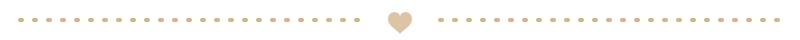

<br>
<br>

</div>


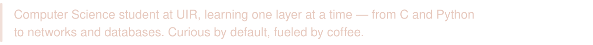


<br>

<div align="center"></div>

<br>
<br>


<div align="center">


<br><br>

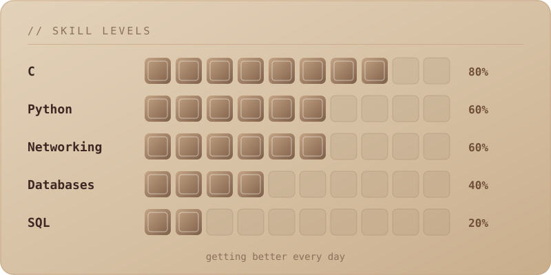

<br><br>


</div>

<br>

<div align="center"></div>

<br>
<br>


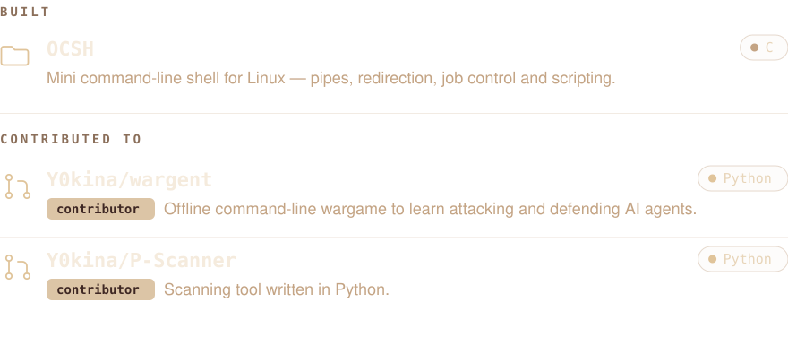

<br>

<div align="center"></div>

<br>
<br>



### 🌸 My Journey

```mermaid
%%{init: {'theme':'base','themeVariables':{'fontSize':'22px','primaryColor':'#F5DEB3','primaryTextColor':'#6F4E37','primaryBorderColor':'#A9746E','lineColor':'#A9746E','secondaryColor':'#FFF8F0','tertiaryColor':'#FFF8F0'}}}%%
flowchart LR
    A([💻 C]) --> B([🐍 Python])
    B --> C([🌐 Networking])
    C --> D([🗄️ Databases])
    D --> E([🔜 SQL])
    E --> F([✨ What is next?])
    style A fill:#D2B48C,stroke:#6F4E37,color:#3E2723
    style B fill:#C19A6B,stroke:#6F4E37,color:#3E2723
    style C fill:#A9746E,stroke:#6F4E37,color:#FFF8F0
    style D fill:#8B6F5A,stroke:#6F4E37,color:#FFF8F0
    style E fill:#6F4E37,stroke:#3E2723,color:#FFF8F0
    style F fill:#F4C2C2,stroke:#A9746E,color:#6F4E37
```

<div align="center"></div>

### 🧸 Tech Stack

<div align="center">


<br><br>


<br>

🗣️ Languages


</div>

<br>

<div align="center"></div>

<br>
<br>


<details>
<summary><b>Click to open ☕</b></summary>

```python
# A tiny profile written in Python
class Inas:
    def __init__(self):
        self.color = "brown"
        self.drink = "coffee"
        self.curious = True

    def learn(self, topic):
        return f"Inas is learning {topic} 🤎"

inas = Inas()
print(inas.learn("SQL"))
```

</details>


<div align="center">


<br>


<br>


</div>


<div align="center">

<picture>
  <source media="(prefers-color-scheme: dark)" srcset="https://raw.githubusercontent.com/inasbsgt/inasbsgt/output/github-contribution-grid-snake-dark.svg" />
  <source media="(prefers-color-scheme: light)" srcset="https://raw.githubusercontent.com/inasbsgt/inasbsgt/output/github-contribution-grid-snake.svg" />
  
</picture>

</div>

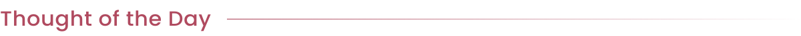


<br>

<div align="center"></div>

<br>
<br>

